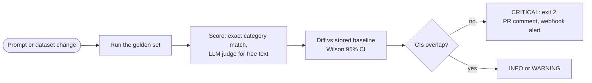
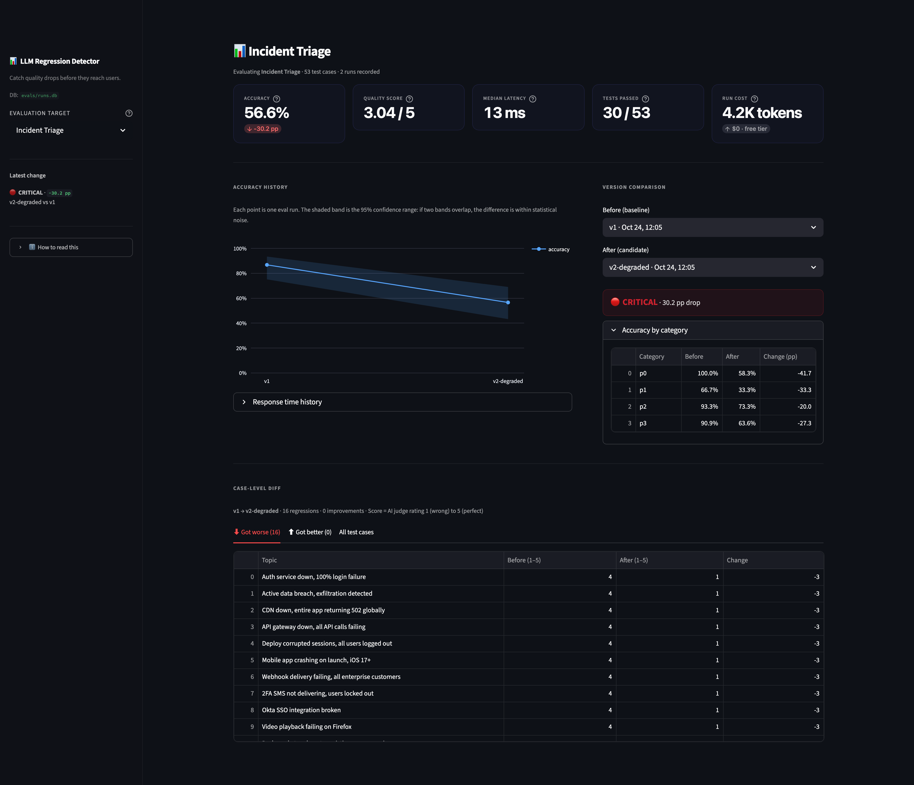

# llm-regression-detector

A CI quality gate for teams that ship prompts and agents: it scores every change against a labelled test set and blocks the merge only when the drop is statistically real.

[](https://github.com/adel-saoud/llm-regression-detector/actions/workflows/ci.yml)
[](pyproject.toml)
[](LICENSE)


## Why

A prompt tweak, a model swap or slow drift can break an LLM feature without a single test failing.
Comparing two accuracy percentages is not enough: on a 50-case test set, a drop under 20 points cannot be told apart from noise.
This tool runs the test set on every change and only fails the build when the 95% confidence intervals stop overlapping.

## Try it

No API key, under a minute, on the bundled mock model:

```bash
git clone https://github.com/adel-saoud/llm-regression-detector
cd llm-regression-detector
uv sync

# 1. Record a baseline
uv run lrd run -p prompts/incident_triage_v1.yaml --no-diff --no-notify

# 2. Run a deliberately degraded prompt and diff it against the baseline
uv run lrd run -p prompts/demo/incident_triage_v2_degraded.yaml --no-notify
```

The second command prints `CRITICAL · accuracy -30.19 pp significant` and exits with code 2, which is what fails a CI job.

On a real model with no key, install [Ollama](https://ollama.com), run `ollama pull qwen3.5:0.8b` and `ollama pull qwen3.5:4b`, and set `LRD_CUSTOM_MODEL=ollama/qwen3.5:0.8b`; the 4b model is the default judge. On a hosted model, put a free Hugging Face token in `.env` (`cp .env.example .env`, then set `HF_TOKEN`) or point `LRD_CUSTOM_MODEL` at any litellm provider, and set `LRD_JUDGE_MODEL` to a different model. See [docs/configuration.md](docs/configuration.md).

On your own task:

- `uv run lrd init` writes a starter prompt YAML and golden dataset.
- Free-text answers are scored too: a case can carry a `reference_answer` and a `rubric` of pass or fail criteria. See [docs/golden-dataset-guide.md](docs/golden-dataset-guide.md).
- To score an agent instead of a prompt, export its answers to a predictions JSONL file and run `uv run lrd score --dataset X --predictions Y`. Same judge, diff and exit codes, no prompt re-run.

## How it works



1. Each prompt YAML names its dataset. On a pull request, [`eval.yml`](.github/workflows/eval.yml) evaluates every affected prompt: the prompts that changed, and the prompts whose dataset changed.
2. Category labels are checked in code. A separate judge model, never the model under test, rates free-text answers from 1 to 5 and returns a pass or fail per rubric criterion; `LRD_JUDGE_CONSENSUS_N=3` takes the median and a majority vote.
3. The run is diffed against the latest stored run of the same prompt. Only a drop or a flipped case raises the severity. A drop is CRITICAL only when the Wilson intervals do not overlap; otherwise it is downgraded to WARNING. A large gain stays INFO but is flagged: a jump that size is worth checking for a broken judge or dataset before trusting it.
4. Every report breaks accuracy down per category, because an aggregate can hide one category collapsing. A separate slow-drift check compares the latest run with a moving-average band over recent runs.
5. Results go to an HTML report, a sticky PR comment, and Slack, Google Chat, Discord or any webhook.

`lrd dashboard` opens the run history in Streamlit:



Module map and failure handling: [docs/architecture.md](docs/architecture.md). Folder layout and stack: [docs/project-structure.md](docs/project-structure.md).

## Results

Every number below is regenerated by `uv run python scripts/reproduce.py` (local Ollama, no API key) and recorded, with the Ollama version, model digests, dataset and prompt hashes, package versions and sample sizes, in [`results/manifest.json`](results/manifest.json). The model under test is `qwen3.5:0.8b`, graded by a separate judge, `qwen3.5:4b`, both with thinking off, on the 53 hand-labelled cases in [`golden_dataset/incidents.json`](golden_dataset/incidents.json). Each prompt runs over 3 runs: cells are medians, and accuracy also shows the range.

| Run | Accuracy, median (range) | p0 | p1 | p2 | p3 | Judge score (1 to 5) |
|---|---|---|---|---|---|---|
| Baseline (`incident_triage_v1`) | 37.7% (37.7% to 37.7%) | 25.0% | 26.7% | 46.7% | 54.5% | 3.94 |
| Degraded (`incident_triage_v2_degraded`) | 20.8% (20.8% to 20.8%) | 0.0% | 53.3% | 20.0% | 0.0% | 4.89 |

Verdict per run: WARNING in 3 of 3, accuracy delta -16.98 to -16.98 pp, 14 cases regressed and 5 improved (medians).

The degraded prompt costs 17 points of accuracy, and p0, the category that pages someone, falls to 0%. With 53 cases and a baseline this low the Wilson intervals still overlap, so the detector reports WARNING and lets a human decide rather than failing the build: the small-sample guard working as designed. The judge score moves the other way: it grades the summary text, and the 4b judge rates the degraded prompt's summaries higher. A case passes only with the right category and a judge score of at least 3, so the judge is part of the gate; a judge that is lenient on summaries leaves the category check to catch the regression.

## Design decisions

- [Gate on Wilson interval separation, not on a raw accuracy delta](docs/adr/0001-gate-on-wilson-interval-separation.md): why 53 cases report a 17-point drop as WARNING.
- [A separate judge model that can never be the model under test](docs/adr/0003-separate-judge-model.md): self-preference bias, and why the judge has no fallback.
- [A versioned dataset contract](docs/adr/0005-versioned-dataset-schema-contract.md): the JSON Schema other repos validate against, and how it may change.

All decisions: [docs/adr/README.md](docs/adr/README.md).

## Limits

- 53 cases catch large regressions only: at 50 cases the intervals separate at a 20 to 26 point drop. A 5-point drop needs about 430 cases at a 95% baseline and 870 at 85% (the `sensitivity` section of [`results/manifest.json`](results/manifest.json), table in [docs/golden-dataset-guide.md](docs/golden-dataset-guide.md#how-many-cases-do-you-need)).
- Ollama output is not bit-stable across calls, even at temperature 0: requests batched with other clients change the arithmetic. Repeats inside one `reproduce.py` call matched exactly, but three calls on 24 October 2026 with the same `lrd` code (before the judge parsing fix) gave baselines of 41.5%, 37.7% and 34.0%, and verdicts CRITICAL at -26.42 pp, WARNING at -22.64 pp and WARNING at -18.87 pp. Those calls are not in the manifest. Treat a verdict near the CRITICAL boundary as provisional and rerun it.
- The Wilson interval covers pass or fail. The 1 to 5 summary score has no interval yet; a bootstrap CI would fix that and is not built.
- Majority vote reduces judge noise, but it repeats the same model, so it cannot correct that model's systematic bias. Spot-check rubric verdicts by hand before trusting a new rubric.
- No pairwise judging (baseline and candidate compared on the same case). Why it is not built yet: [ADR 0008](docs/adr/0008-no-pairwise-judge-yet.md).
- It measures answer quality, not robustness to prompt injection.
- Free-tier providers rate-limit. The router retries with backoff, but large datasets may need a paid tier.

## Part of a system

- [trace-to-golden](https://github.com/adel-saoud/trace-to-golden) turns reviewed production traces into cases in this repo's dataset format.
- [agent-mesh](https://github.com/adel-saoud/agent-mesh) exports its answers per suite as a predictions file that `lrd score` grades without re-running the agents.

## Development

```bash
uv sync --all-extras
uv run pre-commit install --hook-type pre-commit --hook-type commit-msg
uv run pre-commit run --all-files   # ruff, pyright strict, gitleaks
uv run pytest                       # coverage floor 90%
```

Releases: `uv run cz bump` updates the version, `CHANGELOG.md` and the `v*` tag; the GitHub release is written from that CHANGELOG entry. The package is not on PyPI; install it from GitHub with `uv tool install git+https://github.com/adel-saoud/llm-regression-detector`. Dataset format: [docs/golden-dataset-guide.md](docs/golden-dataset-guide.md). Planned GitHub Action: [docs/github-action.md](docs/github-action.md). Extension points: [docs/extending.md](docs/extending.md).

## License

[MIT](LICENSE)
