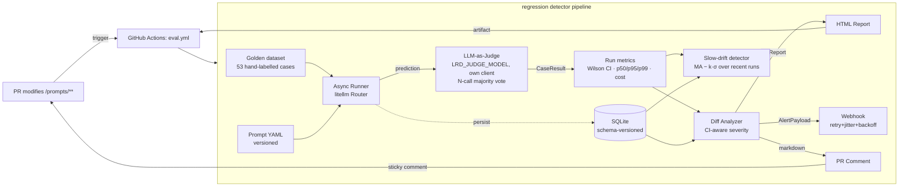
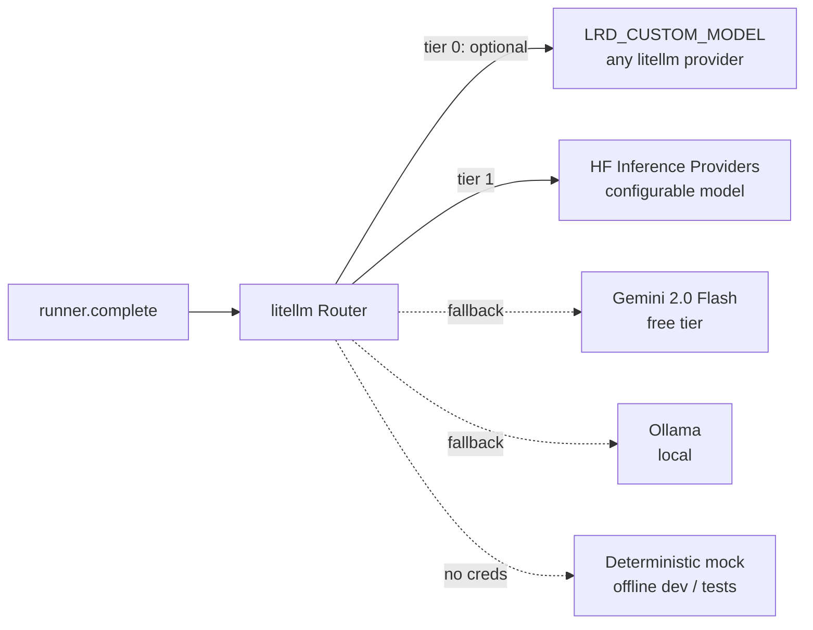
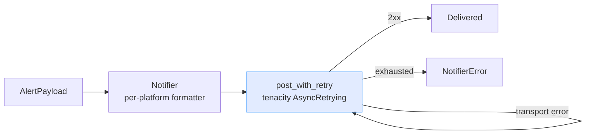

# Architecture

## High-level pipeline

## Provider fallback chain (LLM Router)

The Router tries providers in declared order and retries within each. Every
model id is configurable via `Settings`:

| Env var | Purpose |
|---|---|
| `LRD_CUSTOM_MODEL` | Any [litellm model string](https://docs.litellm.ai/docs/providers): slots in as the highest-priority tier |
| `LRD_CUSTOM_API_KEY` | API key for the custom provider |
| `LRD_CUSTOM_API_BASE` | Base URL override (auto-set for `ollama/` models) |
| `LRD_HF_MODEL` | Model for HF Inference Providers tier |
| `LRD_GEMINI_MODEL` | Model for Gemini tier |
| `LRD_OLLAMA_MODEL` | Model for Ollama tier |
| `LRD_REASONING_EFFORT` | Thinking budget for Ollama models, `none` by default |
| `LRD_JUDGE_MODEL` | The judge, on its own single-model client with no fallback |

The judge never shares the chain above: a fallback could hand grading to the model
being graded. Settings reject a judge equal to the first model of the chain.

Model ids live only in the `Settings` defaults (`config.py`); switching models is a
configuration change. The full default
chain costs $0: every built-in provider has a free tier or runs locally.

## Webhook delivery

3 attempts · `wait_exponential_jitter(initial=0.5s, max=2.0s, jitter=0.25)`
· retries on 408, 425, 429, 500, 502, 503, 504 and `httpx.HTTPError`; any other 4xx
or 5xx fails at once. Jitter avoids thundering-herd collisions when multiple
processes retry the same webhook.

## Module boundaries

| Module | Responsibility | Key types |
|---|---|---|
| `config` | env-driven settings, model + cost overrides, platform detection | `Settings`, `WebhookPlatform`, `LogLevel` |
| `llm.client` | provider-agnostic completion via litellm Router | `LLMClient`, `LLMResponse`, `RouterClient` |
| `llm.mock` | deterministic in-process LLM stub | `MockLLMClient` |
| `eval.dataset` | typed data + YAML/JSON loaders; dataset schema v1 (bare array) and v2 (versioned wrapper) | `GoldenCase`, `GoldenDataset`, `PromptSpec`, `OutputFormat`, `EvalRun`, `RunSummary`, `CategoryAccuracy` |
| `eval.runner` | async batched orchestration over two output sources (prompt under test, or a predictions file); computes CI / percentiles / cost / per-category | `Runner` |
| `eval.scorer` | exact-match category check + LLM-as-Judge quality score and per-criterion rubric verdicts, with optional N-call consensus | `Judge`, `JudgeScore`, `CriterionVerdict` |
| `eval.parsing` | tolerant JSON extraction; reads model output into a prediction per `output_format` | `extract_json_object`, `Prediction`, `parse_prediction` |
| `eval.stats` | Wilson 95% CI · percentiles · slow-drift detection (pure, dependency-free) | `WilsonInterval`, `DriftSignal`, `wilson_interval`, `percentile`, `detect_slow_drift` |
| `diff.analyzer` | CI-aware regression detection + severity logic | `Analyzer`, `DiffReport`, `Thresholds` |
| `diff.drift` | slow-drift wrapper over `EvalRun` history | `DriftReport`, `analyze_drift` |
| `notify.base` | Notifier Protocol + shared payload model | `Notifier`, `AlertPayload`, `NullNotifier` |
| `notify.transport` | shared HTTP retry/backoff/jitter policy | `post_with_retry` |
| `notify.{slack,google_chat,discord,generic}` | per-platform format + delivery | `SlackNotifier` etc. |
| `storage.sqlite` | run history + schema-versioned forward migration; `recent_any` for cross-prompt lookup | `SQLiteStorage` |
| `report.html` | Jinja2-driven HTML report renderer | `render_html`, `write_html` |
| `report.pr_comment` | GitHub-flavoured markdown summary | `render_pr_comment` |
| `dashboard.app` | Streamlit dashboard with a two-column layout: accuracy history with CI band + version comparison panel (category breakdown, regression/improvement tabs) | n/a |
| `ci` | picks the prompts a change set affects (changed prompt file, or changed dataset named by a prompt's `dataset` key) | `affected_prompts` |
| `cli` | typer entry point | `lrd run`, `lrd diff`, `lrd report`, `lrd pr-comment`, `lrd dashboard`, `lrd init`, `lrd score`, `lrd affected-prompts`, `lrd schema` |

## Why these choices

- **`litellm` Router**: one wire format (OpenAI chat) for 100+ models. Adding a provider is one branch in `_build_router`. Model IDs come from `Settings`, never hardcoded.
- **Wilson 95% confidence intervals**: eval datasets are small; the normal-approximation interval breaks at small N. Wilson is the textbook choice and fits in 30 lines of stdlib `math` (no `scipy` needed). Severity is downgraded when intervals overlap so the system doesn't fire false alarms.
- **N-call majority-vote judging**: single-call LLM-as-Judge is noisy; with N calls the score is the median and each rubric criterion a majority vote, at N times the judge cost. Configurable via `LRD_JUDGE_CONSENSUS_N` so cost-minimal runs and production-grade alerts share the same code path.
- **Checks derived from the golden case**: a case is scored on the fields it sets: exact-match category in code, a 1 to 5 judge quality score, and one pass or fail judge verdict per rubric criterion (the shape Vertex AI uses for rubric-based metrics). A case passes only when all of its checks pass. Details in [`golden-dataset-guide.md`](golden-dataset-guide.md).
- **Slow-drift detector**: PR-level diffs catch sudden regressions; an `MA − k·σ` band over recent runs catches the slow tightening that one-shot diffs miss.
- **`tenacity` with jittered exponential backoff**: webhook delivery must survive transient 5xx; jitter avoids thundering-herd retry collisions. Centralised in `notify.transport` so every platform uses identical policy.
- **Pydantic v2 with `frozen=True, extra="forbid"`**: runtime validation doubles as documentation; serialisation for SQLite is `model_dump_json`. Strict-by-default.
- **Schema-versioned SQLite**: `eval_runs` rows are tagged with `schema_version`; `_migrate_payload` forward-fills new fields with sensible defaults so old rows survive non-additive changes.
- **Protocols over ABCs** for `Notifier` and `LLMClient`: duck-typed, no inheritance, trivial to test with `NullNotifier` / `MockLLMClient`.
- **Mock provider in `llm.mock`**: the full pipeline runs offline with no keys, which is what makes the test suite hermetic, the dev loop free, and the demo runnable without an API key.
