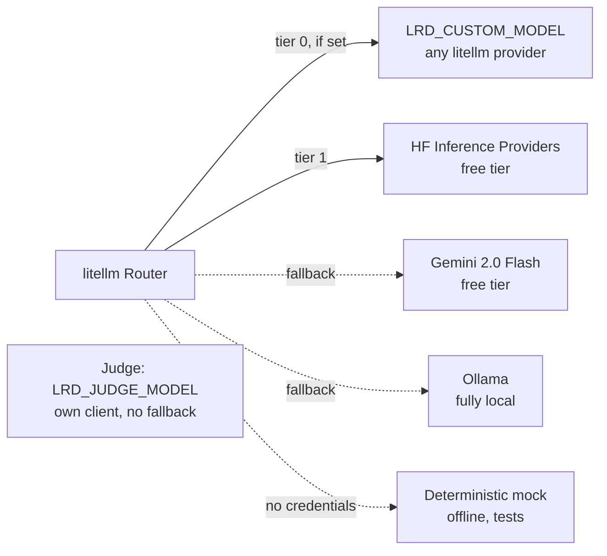

# Configuration

Every setting is an environment variable, read by `pydantic-settings` from the
shell or from a `.env` file in the working directory. Copy
[`.env.example`](../.env.example) to `.env` to start. Nothing is required: with no
credentials at all, `lrd` runs on the deterministic mock.

Settings are checked at startup. Any `LRD_*` variable in the environment that is
not in the table below, and any unknown key in `.env`, stops the command with
exit code 1 and names the closest valid setting, so a typo such as
`LRD_CONCURENCY` fails loudly instead of being ignored. `HF_TOKEN` and
`GEMINI_API_KEY` keep their vendor names and carry no prefix.

## Provider chain

The default chain costs nothing. Set `LRD_CUSTOM_MODEL` to put your own provider first.

`LRD_CUSTOM_MODEL` takes any [litellm model string](https://docs.litellm.ai/docs/providers),
for example `ollama/qwen3.5:0.8b`, `anthropic/claude-haiku-4-5` or `openai/gpt-4o-mini`.
`ollama/` models are detected as local and need no key.

## Judge model

The judge is a separate model with its own client. A model that grades its own
answers rates them higher ([Panickssery et al., 2024](https://arxiv.org/abs/2404.13076)),
so `lrd` refuses to start when `LRD_JUDGE_MODEL` names the first model of the chain
under test, and the judge never falls back to that chain. The mock plays both roles.
With HF or Gemini as the model under test, the default judge is still local Ollama:
set `LRD_JUDGE_MODEL` to another provider if Ollama is not running.

## Reference

| Variable | Default | Purpose |
|---|---|---|
| `LRD_CUSTOM_MODEL` | unset | litellm model string tried before the built-in tiers |
| `LRD_CUSTOM_API_KEY` | unset | API key for the custom provider |
| `LRD_CUSTOM_API_BASE` | unset | Base URL for the custom provider (set automatically for `ollama/`) |
| `HF_TOKEN` | unset | Hugging Face token, enables tier 1 |
| `GEMINI_API_KEY` | unset | Google AI Studio key, enables tier 2 |
| `LRD_OLLAMA_BASE_URL` | `http://localhost:11434` | Ollama server for tier 3 |
| `LRD_HF_MODEL`, `LRD_GEMINI_MODEL`, `LRD_OLLAMA_MODEL` | see `.env.example` | Model under test per built-in tier. `LRD_OLLAMA_MODEL` defaults to `ollama/qwen3.5:0.8b` |
| `LRD_REASONING_EFFORT` | `none` | Thinking budget for Ollama models (`none`, `low`, `medium`, `high`), sent through litellm's `reasoning_effort` as Ollama's `think`. `none` matters: Qwen3.5 thinks by default and can spend the whole token budget before answering. Not sent to HF or Gemini |
| `LRD_JUDGE_MODEL` | `ollama/qwen3.5:4b` | litellm model string of the judge. It has no fallback, and startup fails when it equals the model under test |
| `LRD_JUDGE_API_KEY`, `LRD_JUDGE_API_BASE` | unset | Key and base URL for the judge provider (base set automatically for `ollama/`) |
| `LRD_JUDGE_CONSENSUS_N` | `1` | Judge calls per case. `3` takes the median score and a majority vote per rubric criterion, at 3 times the judge cost |
| `LRD_COST_INPUT_USD`, `LRD_COST_OUTPUT_USD` | `0.0` | Price per million tokens, so reports show real spend on a paid model |
| `LRD_WEBHOOK_URL` | unset | Alert destination. Slack, Google Chat and Discord are detected from the URL; anything else gets the generic JSON payload |
| `LRD_WEBHOOK_PLATFORM` | detected | Force `slack`, `google_chat`, `discord` or `generic` |
| `LRD_LOG_LEVEL` | `INFO` | structlog level |
| `LRD_CONCURRENCY` | `10` | Cases evaluated at once per run (1 to 100, capped at 50 on the mock). Judge consensus calls run inside a case's slot, so model calls in flight can reach this times `LRD_JUDGE_CONSENSUS_N` |
| `LRD_DB_PATH` | `evals/runs.db` | SQLite file the Streamlit dashboard reads. `lrd dashboard --db` sets it; the other commands take `--db` instead |

How the router and the retry policy use these values is described in
[architecture.md](architecture.md).
